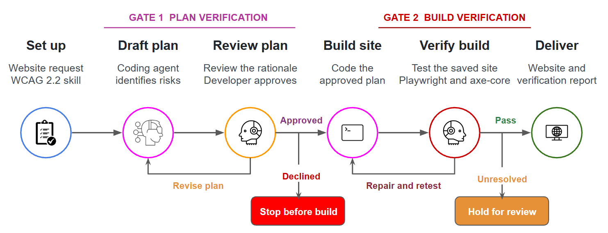

# Socratic Plan Verification

Socratic Plan Verification (SPV) is an agent workflow for building and changing web interfaces. It puts an accessibility review before implementation and a browser verification step after implementation. Use it in a coding harness with subagents, or run the same roles in separate chats.



*Figure 2 from the SE4ALL paper, [From Guidance to Verification: Improving Web Accessibility in Agentic Software Development](docs/workflow.md#paper-figure).*

## Install in your project

Clone this repository and run the installer from its root. It uses Python 3.11 or later and the standard library. Replace `PROJECT_PATH` and choose one harness.

```sh
git clone https://github.com/mors-templar/socratic-plan-verification.git
cd socratic-plan-verification
python scripts/install.py --project "PROJECT_PATH" --harness codex
```

Use `py -3` if Windows uses the Python launcher, or `python3` if your shell uses that command. Add `--dry-run` to preview the paths. The installer stops if an existing destination differs.

| Harness | Installer argument | Native agent and skill locations |
| --- | --- | --- |
| Codex | `codex` | `.codex/agents/` and `.agents/skills/` |
| Claude Code | `claude` | `.claude/agents/` and `.claude/skills/` |
| OpenCode | `opencode` | `.opencode/agents/` and `.opencode/skills/` |
| Other harnesses | `generic` | `.spv/` for manual loading |

Each option installs the portable files under `.spv/`. For manual installation, copy `agents/`, `skills/`, and [START.md](START.md) under `.spv/` in your project. For a chat with no filesystem access, paste or attach the [coordinator](agents/spv-coordinator.md), [skill](skills/spv-accessibility/SKILL.md), and [checklist](skills/spv-accessibility/references/checklist.md). Pass the individual role instructions and evidence to separate chats as needed.

Open a fresh session from the target project. Paste the [starter prompt](START.md) and replace its placeholder with your request. The primary agent coordinates SPV. It can delegate to the installed roles or ask you to run a role in a separate session.

## Use SPV

1. Give the coordinator a web task and name the journeys or states that matter. It drafts a plan and a list of observable checks.
2. A plan reviewer compares the plan with your original request, then asks a specific question about a material accessibility risk. Answer it, review the revision, and approve that exact plan before implementation.
3. The builder implements the approved revision. A verifier runs the relevant interactions and checks against the actual build. For failed checks, the builder repairs the issue and the verifier tests the changed build.
4. Read the scoped report. It identifies what passed, what failed, and what still needs manual evidence. Resolve required failures or missing evidence before calling the build verified.

Try the [delete-dialog example](examples/delete-dialog.md) to see the prompts, evidence, and handoff. See [Workflow and role handoffs](docs/workflow.md) for the full process, including a manual route when native subagents are unavailable.

## What is included

| Component | Responsibility |
| --- | --- |
| [Coordinator](agents/spv-coordinator.md) | Draft the plan, collect the developer's answer and approval, and route work between roles |
| [Plan reviewer](agents/spv-plan-reviewer.md) | Challenge a task-specific risk and review the exact revised plan |
| [Builder](agents/spv-builder.md) | Implement an approved plan and repair verified failures |
| [Verifier](agents/spv-verifier.md) | Check the running build and report evidence for each requirement |
| [Accessibility skill](skills/spv-accessibility/SKILL.md) | Select applicable accessibility checks and distinguish automated from manual evidence |

The kit supplies prompts and native agent definitions. The harness controls tool access and permissions. For tool-enforced gates, run planning and review with write access disabled and grant build access only after approval. Use your project's browser tools or perform the checks manually. A pass applies to the listed checks and the tested build.

Native installation paths follow the [Codex agent](https://developers.openai.com/codex/subagents/) and [skill](https://developers.openai.com/codex/skills/) docs, the [Claude Code agent](https://code.claude.com/docs/en/sub-agents) and [skill](https://code.claude.com/docs/en/skills) docs, and the [OpenCode agent](https://opencode.ai/docs/agents/) and [skill](https://opencode.ai/docs/skills/) docs.
